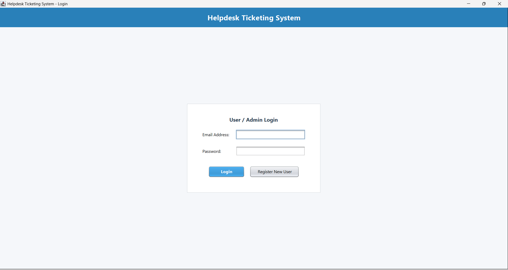
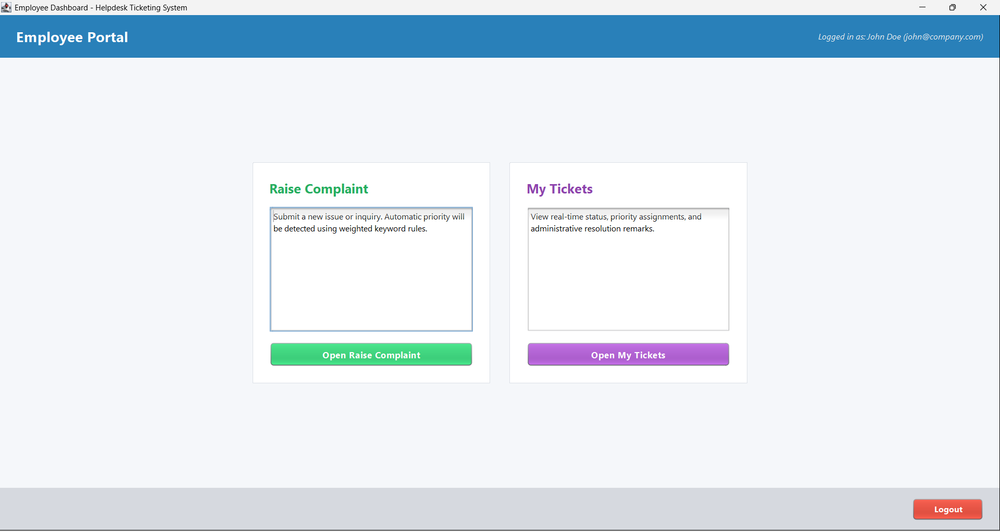
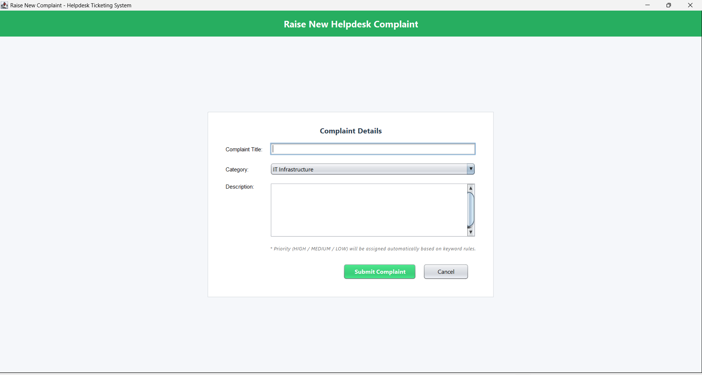
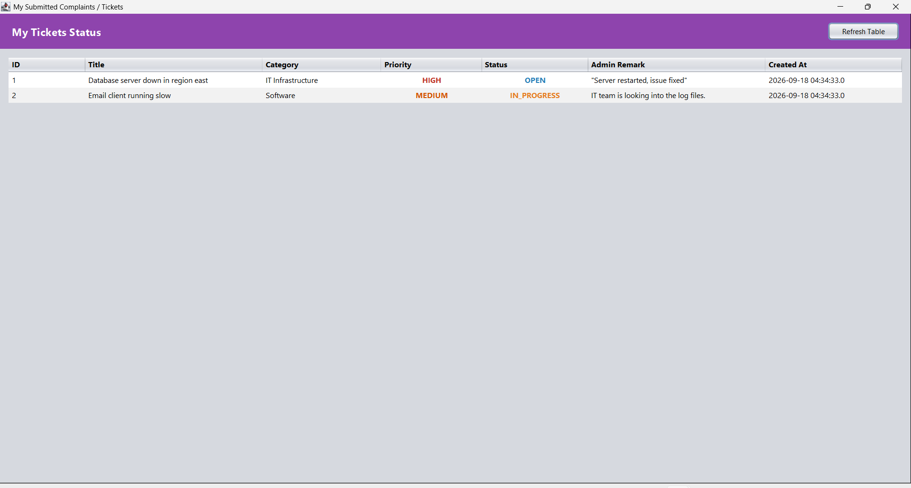
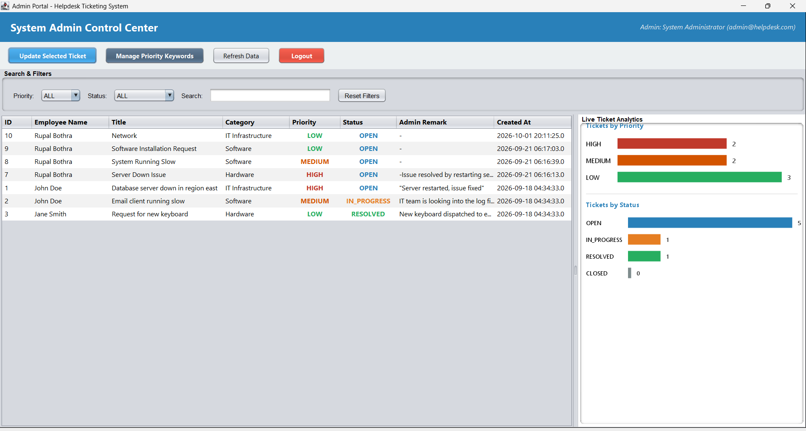
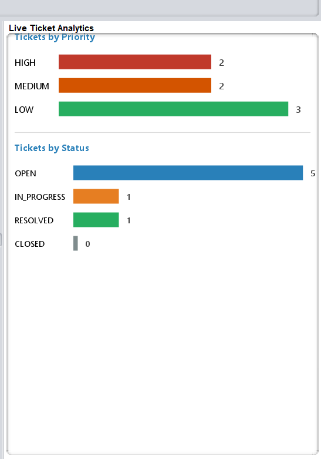
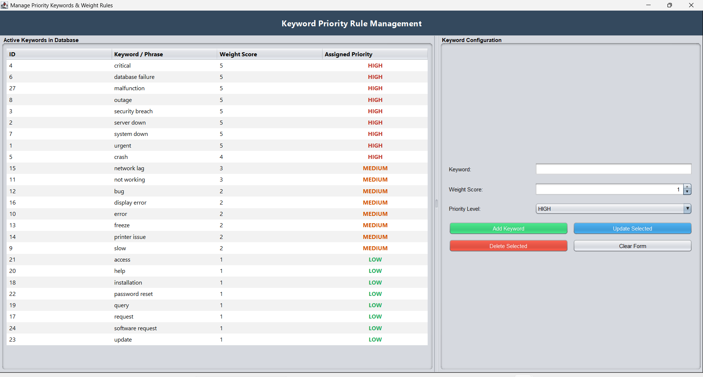

# Helpdesk Complaint & Ticketing System

A desktop-based **Helpdesk Management Application** developed using **Java Swing, JDBC, and MySQL**. The system provides role-based access for Employees and Administrators, featuring an automated complaint priority assignment engine powered by dynamic, weighted keywords.

---

## 📌 Table of Contents

- [Overview](#overview)
- [Features](#features)
- [Tech Stack](#tech-stack)
- [Project Structure](#project-structure)
- [Prerequisites](#prerequisites)
- [Database Setup](#database-setup)
- [Credentials Configuration](#credentials-configuration)
- [JDBC Driver Configuration](#jdbc-driver-configuration)
- [Priority Detection Engine](#priority-detection-engine)
- [Running the Application](#running-the-application)
- [Screenshots](#screenshots)
- [Security Notice](#security-notice)

---

## 📖 Overview

The **Helpdesk Complaint & Ticketing System** is a desktop application designed to simplify complaint management within an organization.

Employees can raise complaints, track their tickets, and view their status, while Administrators can manage complaints, update ticket statuses, and configure priority keywords.

The application automatically assigns complaint priorities using a **weighted keyword-based detection mechanism**.

---

## ✨ Features

### 👨‍💻 Employee Module

- Employee registration and login.
- Raise new complaints.
- View submitted complaints and ticket statuses.
- Track complaint progress.

### 🛠️ Administrator Module

- Dedicated administrator login.
- View and manage employee complaints.
- Update ticket statuses.
- Manage priority keywords and their weights.
- View complaint analytics.

### ⚡ Automated Priority Detection

- Dynamic keyword-based complaint analysis.
- Weighted scoring mechanism.
- Automatic assignment of HIGH, MEDIUM, and LOW priorities.
- Configurable keywords through the Admin Dashboard.

---

## 💻 Tech Stack

| Technology | Purpose |
|---|---|
| Java | Core application logic |
| Java Swing | Graphical User Interface |
| JDBC | Database connectivity |
| MySQL | Database management |
| Apache Ant | Project build and execution |
| NetBeans IDE | Development environment |

---

## 📂 Project Structure

```text
HelpdeskTicketingSystem/
│
├── src/
│   ├── dao/
│   │   ├── KeywordDAO.java
│   │   ├── TicketDAO.java
│   │   └── UserDAO.java
│   │
│   ├── db/
│   │   └── DBConnection.java
│   │
│   ├── model/
│   │   ├── Keyword.java
│   │   ├── Ticket.java
│   │   └── User.java
│   │
│   ├── service/
│   │   └── PriorityService.java
│   │
│   ├── ui/
│   │   ├── AdminDashboard.java
│   │   ├── ComplaintFrame.java
│   │   ├── LoginFrame.java
│   │   ├── ManageKeywordsFrame.java
│   │   ├── MyTicketsFrame.java
│   │   ├── RegisterFrame.java
│   │   ├── UITheme.java
│   │   ├── UpdateTicketFrame.java
│   │   └── UserDashboard.java
│   │
│   └── Main.java
│
├── lib/
│   └── mysql-connector-j-8.3.0.jar
│
├── Screenshorts/
│   ├── 1_login.png
│   ├── 2_employee_dashboard.png
│   ├── 3_raise_complaint.png
│   ├── 4_my_tickets.png
│   ├── 5_admin_dashboard.png
│   ├── 6_analytics.png
│   └── 7_manage_keywords.png
│
├── schema.sql
├── build.xml
├── manifest.mf
├── .gitignore
└── README.md
```

---

## ⚙️ Prerequisites

Make sure the following software is installed:

- **Java JDK 8 or above**
- **MySQL Server**
- **MySQL Workbench** (optional)
- **Apache NetBeans IDE**
- **Apache Ant**

---

## 🗄️ Database Setup

1. Start your MySQL Server.
2. Open MySQL Workbench or MySQL Command Line Client.
3. Execute the SQL script provided in the project.

```sql
SOURCE path/to/schema.sql;
```

Alternatively, open `schema.sql` in MySQL Workbench and execute the complete script.

This will create the required database, tables, and demo records.

---

## 🔐 Credentials Configuration

The application uses environment variables for database credentials instead of storing the MySQL password directly in the source code.

Set the following **Windows User Environment Variables**:

| Variable | Value |
|---|---|
| `DB_USER` | Your MySQL username |
| `DB_PASSWORD` | Your MySQL password |

### Steps to Configure

1. Search for **Edit environment variables for your account** in Windows.
2. Open the Environment Variables settings.
3. Under User Variables, click **New**.
4. Add `DB_USER` and enter your MySQL username.
5. Add `DB_PASSWORD` and enter your MySQL password.
6. Save the changes and restart NetBeans.

### Demo Login Credentials

The following accounts are provided for local testing:

| Role | Email | Password |
|---|---|---|
| Admin | `admin@helpdesk.com` | `admin123` |
| Employee | `john@company.com` | `user123` |
| Employee | `jane@company.com` | `user123` |

**Note:** These are demo credentials only. They should be changed before using the application in any real environment.

---

## 🔌 JDBC Driver Configuration

The MySQL JDBC driver is included in the `lib/` directory.

```text
lib/mysql-connector-j-8.3.0.jar
```

Ensure that this JAR file is added to the project's libraries or classpath in NetBeans.

---

## 🎯 Priority Detection Engine

The application uses a **weighted keyword-based scoring system** to determine complaint priority.

| Priority | Condition |
|---|---|
| **HIGH** | A HIGH-category keyword with weight ≥ 5 is detected, OR total score ≥ 8 |
| **MEDIUM** | Total score ≥ 3 |
| **LOW** | Total score below 3 |

Administrators can manage keywords, categories, and weights through the **Manage Keywords** section.

---

## ▶️ Running the Application

### Using NetBeans IDE

1. Open Apache NetBeans IDE.
2. Select **File → Open Project**.
3. Choose the `HelpdeskTicketingSystem` folder.
4. Verify that the MySQL JDBC driver is included in the project libraries.
5. Ensure the database is running and environment variables are configured.
6. Run the project using **Run Project**.

### Using Apache Ant

Open a terminal in the project directory and execute:

**Build the project:**

```bash
ant jar
```

**Run the application:**

```bash
ant run
```

---

## 📸 Screenshots

### 1. Login Page



### 2. Employee Dashboard



### 3. Raise Complaint



### 4. My Tickets



### 5. Admin Dashboard



### 6. Analytics



### 7. Manage Keywords



---

## ⚠️ Security Notice

- Database credentials are configured through environment variables.
- Demo login credentials are included for testing purposes.
- The current implementation uses plaintext password storage.
- This project is developed for academic purposes and is **not production-ready**.
- Additional security measures, including password hashing and stronger authentication, are required before real-world deployment.

---

## 👩‍💻 Author

**Rupal Bothra**

B.Tech – Computer Science and Engineering

---